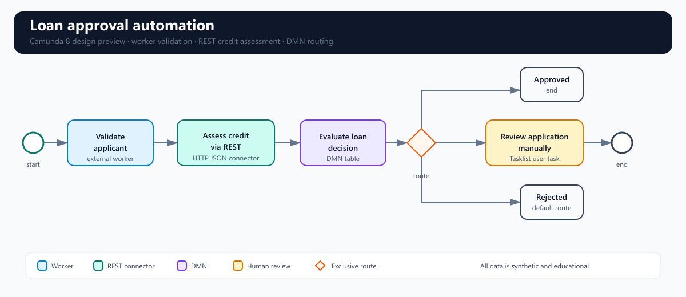
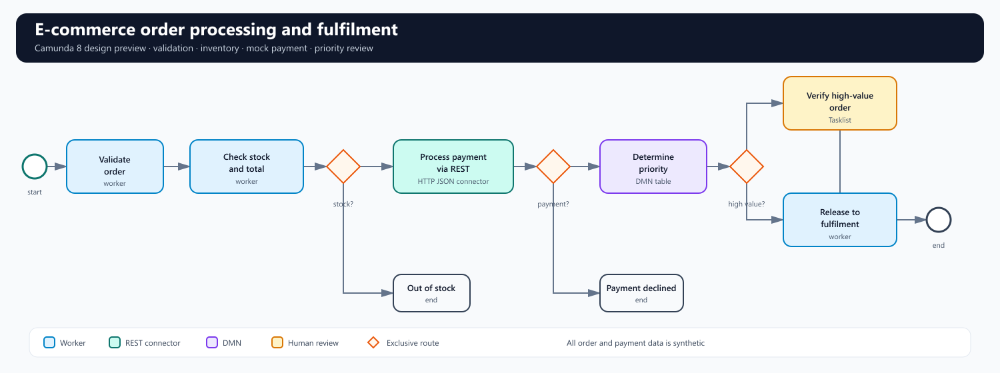
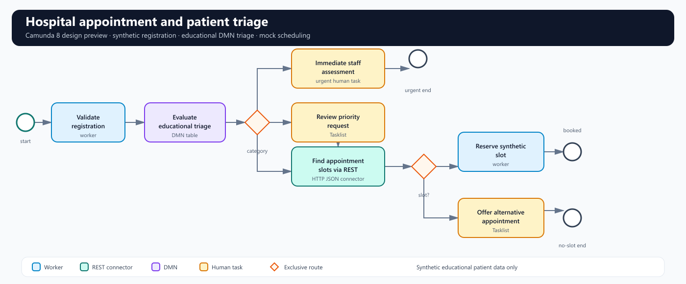

# Workflow Automation 4

Camunda 8 practical assignment covering three small, end-to-end workflow examples:

1. Loan approval automation
2. E-commerce order processing and fulfilment
3. Hospital appointment and patient triage

The repository is designed as an educational submission: the process models are executable Camunda 8 artifacts, the decision rules are explicit and synthetic, and the Java application supplies external job workers plus local mock REST endpoints.

> Evidence note: the diagram images in this repository are labelled design previews. Deployment, Tasklist, Operate, incident, and recovery screenshots are not fabricated. Capture those screenshots from the Camunda environment used for the final demonstration and place them in `docs/evidence/captured/`.

## Repository tour

| Area | Contents |
| --- | --- |
| `models/` | BPMN and DMN files for all three labs |
| `workers/` | Java 17 / Spring Boot external workers and mock REST API |
| `docs/diagrams/` | Clean SVG/PNG design previews for the three BPMN models |
| `docs/variables/` | Process-variable dictionaries and sample payloads |
| `docs/reports/` | Concise lab reports, rules, limitations, and execution notes |
| `docs/evidence/` | Evidence checklist and screenshot capture templates |
| `tests/` | Scenario matrix covering success, rejection, review, and recovery |
| `scripts/` | Local XML/model consistency checks |

## Architecture at a glance

```text
Camunda 8 Orchestration Cluster
        | BPMN service jobs + DMN decisions
        v
Spring Boot worker application
  - validation workers
  - inventory / booking workers
  - local mock REST endpoints
        |
        v
Tasklist for human review  |  Operate for execution and incidents
```

The BPMN models use native Camunda 8 extensions: `zeebe:taskDefinition` for external workers, `zeebe:calledDecision` for DMN, native user tasks for Tasklist, and the Camunda HTTP JSON connector task type for REST calls. Connector URLs are process variables so a student can point the models at a local mock service or a permitted test endpoint without editing the model.

## Visual previews

These are model-design previews for quick review on GitHub. They are intentionally separate from live execution evidence.

### Lab 1 · Loan approval



### Lab 2 · E-commerce order processing



### Lab 3 · Hospital appointment and triage



## Quick start

### 1. Review the models

Open the files under `models/` in Camunda Modeler configured for Camunda 8. The matching PNG/SVG previews are in `docs/diagrams/`.

### 2. Start a Camunda 8 environment

Use one of the following, depending on the course environment:

- Camunda 8 SaaS, with credentials supplied through environment variables.
- Camunda 8 Run or another self-managed development cluster exposing Zeebe gRPC on `localhost:26500` and REST on `localhost:8088`.

The repository does not include credentials, cluster tokens, or deployment claims. See `docs/setup.md` for both connection profiles and deployment steps.

### 3. Start the worker and mock services

```powershell
cd workers
$env:CAMUNDA_CLIENT_MODE = "self-managed"
mvn spring-boot:run
```

The mock endpoints are available at `http://localhost:8080/mock/` and are intentionally deterministic. They accept only synthetic educational data.

### 4. Deploy the models

Deploy the BPMN and DMN file for one lab together from Camunda Modeler. The process and decision IDs are listed in each lab report. Then start an instance with the sample payloads under `docs/variables/`.

### 5. Capture genuine evidence

Follow `docs/evidence/README.md`. Replace the templates only with screenshots from the running environment: deployed definition, completed/rejected/review instances, Tasklist review task, Operate variables, and an incident before/after retry.

## Common submission checklist

| Assignment item | Repository location | Status |
| --- | --- | --- |
| BPMN model files | `models/*/*.bpmn` | Included |
| BPMN design screenshots | `docs/diagrams/` | Included as design previews |
| DMN model files and rules | `models/*/*.dmn`, `docs/reports/` | Included |
| External worker source and run instructions | `workers/`, `docs/setup.md` | Included |
| REST Connector configuration and examples | BPMN XML, `docs/api-examples.md` | Included |
| Process-variable dictionaries | `docs/variables/` | Included |
| Success, rejection, review, and recovery test cases | `tests/`, lab reports | Included |
| Deployment and workflow-instance evidence | `docs/evidence/captured/` | Capture locally |
| Tasklist human-task evidence | `docs/evidence/captured/` | Capture locally |
| Operate monitoring and incident-recovery evidence | `docs/evidence/captured/` | Capture locally |
| Short reports | `docs/reports/` | Included |

## Assumptions and boundaries

- Baseline: Camunda 8.10-compatible model extensions and the Camunda Spring Boot 3 starter; Java 17 or newer.
- The decision rules are simplified educational rules, not financial underwriting, payment authorization, or clinical guidance.
- All applicant, customer, payment, and patient references are synthetic.
- REST failures are demonstrated by controlled flags such as `simulateApiFailure=true`; no real payment or patient system is called.
- A worker failure is recovered by correcting the synthetic input and retrying the failed job in Operate. The repository does not claim that this was executed here.

## Official references

- [Camunda BPMN modeling](https://docs.camunda.io/docs/components/modeler/bpmn/)
- [Camunda DMN modeling](https://docs.camunda.io/docs/components/modeler/dmn/)
- [Camunda Java job workers](https://docs.camunda.io/docs/apis-tools/java-client/job-worker/)
- [Camunda Spring Boot starter](https://docs.camunda.io/docs/apis-tools/camunda-spring-boot-starter/getting-started/)
- [Camunda HTTP JSON connector](https://docs.camunda.io/docs/components/connectors/protocol/rest/)

## Submission hygiene

Before publishing or submitting, run `scripts/validate-models.ps1`, review the generated output, and confirm that `docs/evidence/captured/` contains only genuine screenshots from the student's own Camunda environment. Never commit client secrets, bearer tokens, real card numbers, or real patient identifiers.
